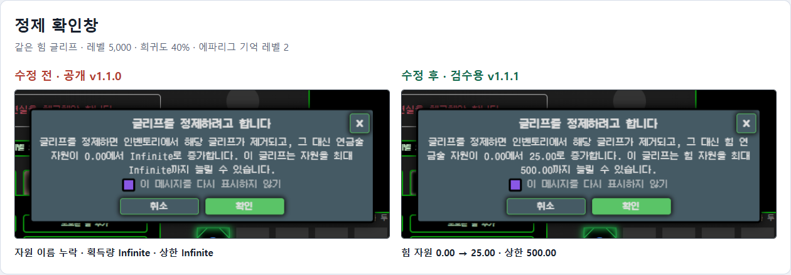
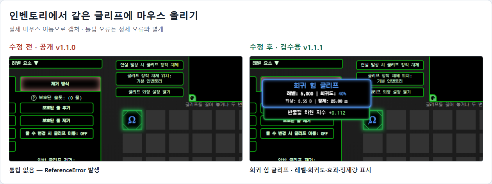
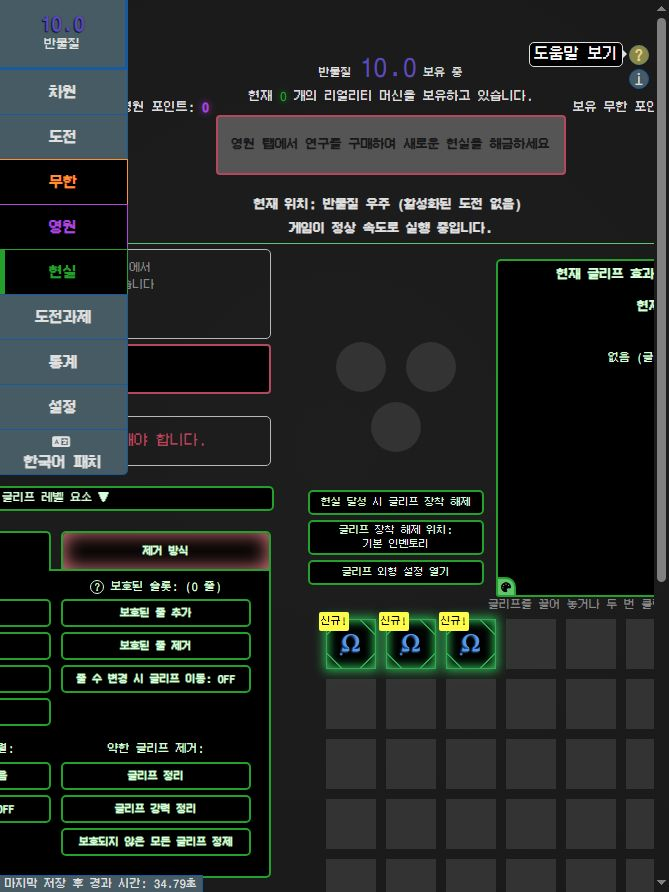

# 이슈 #1 수정 및 검증

대상: Steam 11.5 한국어 패치 1.1.1

공개 1.0.0·1.1.0 및 당시 설치본에서 제보된 두 증상을 재현한 뒤, 수정 소스로 빌드·패키징한 1.1.1의 코드를 다시 추출해 검사했습니다.

## 원인과 수정

| 증상 | 원인 | 수정 |
| --- | --- | --- |
| 정제 획득량·상한 Infinite | 번역된 자원 이름으로 영문 저장 키를 조회 | 자원 데이터베이스의 고정 키로 조회 |
| 일반 글리프 툴팁 미표시 | GLYPH_RARITY_NAMES 정의 누락 | 컴포넌트 안에 희귀도·종류 이름표 정의 |
| 정제창·보상 이름 누락 | displayName getter 및 레벨업 툴팁 표시 속성 누락 | 필요한 표시 속성 구현 |
| 이름 없는 자들의 보상·회상 오류 | 내부 name을 번역해 기존 비교·저장과 불일치 | Enslaved 식별자 유지 및 이전 한국어 저장의 회상 대상 변환 |

## 실제 조작 결과

조건은 에파리그 기억 레벨 2, 레벨 5,000·희귀도 40% 힘 글리프, 자원량 0입니다. 임시 브라우저에서 실제 인벤토리에 마우스를 올린 뒤 Shift+클릭으로 정제 확인창을 열고 확인 버튼을 눌렀습니다.

| 항목 | 공개 1.1.0 | 수정본 1.1.1 |
| --- | --- | --- |
| 확인창 | 자원 이름 누락, 0.00 → Infinite | 힘 0.00 → 25.00, 상한 500.00 |
| 정제 후 힘 자원 | NaN | 25 |
| 나머지 기본 자원 5종 | 모두 NaN | 모두 0 유지 |
| 저장 직렬화 후 힘 자원 | null | 25 |
| 일반 글리프 툴팁 | ReferenceError, 표시되지 않음 | 이름·희귀도·레벨·효과·정제량 표시 |
| Enslaved 회상 대상이 있는 라 탭 | TypeError, 본문 렌더링 실패 | 회상 유지, 본문 표시 |







## 자동 검사

`tools/verify-issue-1.cjs`를 최종 app.asar에서 추출한 AppFiles에 실행합니다. Playwright 모듈 경로는 실행 환경에서 지정합니다. 런타임에는 테스트용 진행도를 포함하지 않으며, 검사 중 임시 브라우저 안에서만 상태를 구성합니다.

```powershell
node tools/verify-issue-1.cjs <추출한-AppFiles> <Playwright-모듈-경로> <결과.json>
```

- 일반 글리프 6종 × 희귀도 8등급의 설명 48개
- 에파리그 레벨 1~25 × 생성 글리프 6종의 해금 경계 150개
- 기본 자원 6종 각각의 실제 정제 및 저장 직렬화
- 이미 정제한 자원의 상한 유지 및 자원 상한 25,000 제한
- 실제 Vue 글리프 툴팁 렌더링과 이름 표시
- 영문·한글 회상 대상의 호환 및 반복 변환 안정성
- 게임 안 버전 표시와 테스트 진행도 코드의 배포본 미포함

결과: [검사 결과 JSON](ISSUE_1_VERIFICATION.json). 변경된 게임 파일 ESLint 및 Steam 빌드도 통과했습니다.

패키징 시 304개 native sidecar 항목이 이전 배포본과 동일한지도 검사했습니다. Steam 네이티브 연동과 사용자의 실제 세이브는 이 브라우저 검사의 범위에 포함하지 않았습니다.

이번 버전은 새로 정제할 때 데이터가 잘못되는 원인을 고칩니다. 이미 잃은 글리프·자원량의 복구를 검증하거나 제공하는 버전은 아닙니다.
